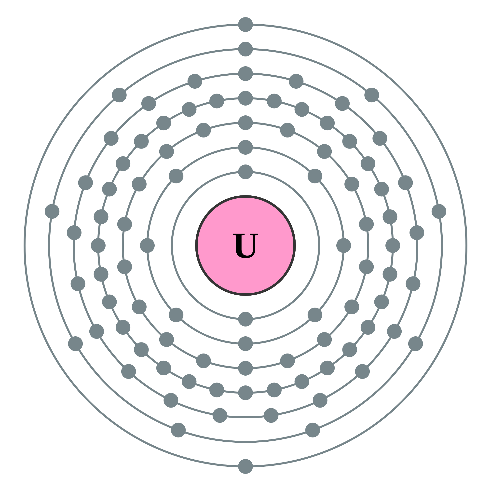

<div align="center">

</div>

# Uranium

a Luau bytecode disassembler/decompiler

## Quick Start

Download the CLI from [GitHub Releases](https://github.com/sbi-n/uranium/releases).
Builds are available for `windows-x86_64`, `macos-aarch64`, and `linux-x86_64`.
Extract the `.tar.gz` (Linux/macOS) or `.zip` (Windows) archive and run `uranium --help`.
Linux binaries target Ubuntu 24.04 or newer compatible systems; macOS binaries target macOS 15 or newer.

Push a version tag, such as `v1.0.0`, to build, test, and publish all three archives
and `SHA256SUMS` automatically. Pushes to `main` and pull requests also build and
test all three platforms and upload archives as Actions artifacts.

## Build

Setup

```bash
brew install cmake ninja
```

Build

```bash
cmake -S . -B build -DBUILD_TESTING=ON
cmake --build build --target uranium ir_tests decompiler_tests -j 4
./build/uranium --help
ctest --test-dir build --output-on-failure
```

## IR

The C++ lifter accepts bytecode from the bundled Luau compiler and returns an owning value:

```cpp
#include "ir.h"
#include "Luau/Compiler.h"

IRContext ir = lift(Luau::compile("return 1 + input"));
std::string text = dump(ir);
```

Function `f0` is the entry point. Function references index `IRContext::functions`; block,
table, and class references index the current function's vectors. PCs count bytecode words,
and block ranges are `[startpc, endpc)`. Every block ends with an explicit terminator.
Load and arithmetic variants share IR operations; constants retain their Luau types.

| Operation | Operands, in order |
| --- | --- |
| `MOVE`, unary, binary | destination, source operand(s) |
| `GETGLOBAL`, `GETUPVAL`, `GETIMPORT` | destination, name/upvalue/import path components |
| `SETGLOBAL`, `SETUPVAL` | name/upvalue, value |
| `GETTABLE` / `SETTABLE` | destination, table, key / table, key, value |
| `NEWTABLE`, `DUPTABLE`, `SETLIST` | destination, hash capacity, array capacity / destination, template / table, first index, values |
| `CLOSURE`, `DUPCLOSURE` | destination, function, captures in upvalue order |
| `NAMECALL` | destination, receiver, method name; also copies receiver to destination + 1 |
| `CALL` | result range, function register, argument range |
| `VARARGS`, `RETURN` | result/return range |
| `CLOSEUPVALS` | first register whose captures must be closed |
| `JUMP`, `BRANCH` | target / condition, operand(s), taken target, fallthrough target |
| `FORNPREP`, `FORNLOOP` | loop base register, taken target, fallthrough target |
| `FORGPREP`, `FORGLOOP` | loop base, target / loop base, variable count, taken target, fallthrough target |
| `NEWCLASS`, `NEWCLASSMEMBER` | destination, shape, superclass or nil, open flag / class, name, value |

Register ranges use `count = -1` for the dynamic stack top and `0` for no values.
Captures distinguish values, register references, and inherited upvalues. Table templates
and class shapes are copied before the temporary VM closes. `IRImmediate` (`#` in dumps)
represents metadata, including the VM function ID for `PROTO_MISMATCH`.

Fast-call hints use their ordinary fallback instructions; their `CALL` retains
`argumentsBeforeCallee` so expression reconstruction preserves the fallback lookup order.
Coverage counters, NOPs, and vararg stack setup are omitted. Runtime-only instructions and invalid instruction boundaries
raise `std::runtime_error`. Input must be compiler-produced bytecode: the Luau loader is
not a validator for arbitrary binary data.

## Decompiler

```cpp
#include "decompiler.h"

std::string source = decompile(bytecode);
```

Link against `uranium_decompiler`. The API returns source rather than writing to stdout;
loading and reconstruction failures throw `std::runtime_error`.

The CLI requires an input file or `-` for standard input. By default it reads compiled
Luau bytecode and writes decompiled source to standard output. Use `--source` to compile
Luau source before decompiling, or `--ir` to print the lifted IR instead.

```bash
./build/uranium --help
./build/uranium compiled.bytecode
./build/uranium compiled.bytecode > recovered.luau
./build/uranium --source example.luau
./build/uranium --ir compiled.bytecode
./build/uranium --source --ir example.luau
./build/uranium --source - < example.luau
```

The stages are independently available through `cfg.h`, `ssa.h`, and `ast.h`:

```cpp
auto cfg = buildCFG(lift(bytecode));
auto ssa = buildSSA(std::move(cfg));
auto ast = buildAST(ssa);
std::string source = printAST(ast);
```

- CFG: reachable edges, dominators, postdominators, dominance frontiers, and natural loops.
- SSA: register liveness, pruned phi placement, dominator-tree renaming, and explicit
  definitions/uses, including call result ranges and loop control registers.
- AST: lexical declarations, expressions, conditions, `if`/`elseif`, `while`, `repeat`,
  numeric/generic `for`, `break`/`continue`, tables, methods, closures, and multiple returns.
  Reference captures remain shared; value captures remain snapshots. Experimental class
  instructions reconstruct class declarations and require the corresponding bundled Luau flags.

Bindings use [Lua Expert v2](https://blog.lua.expert/posts/v2/)-style value-based names.
String-key accesses use the property name (`hello` for both `t.hello` and `t["hello"]`).
Calls use their last valid identifier string argument, including service/child lookups,
attribute lookups, and `Instance.new`. `require` uses the module binding or property;
`GetChildren()` becomes `Children`, `Clone()` becomes `clone`, and two-result `pcall`
assignments use `ok` and `result`. Valid local and function debug names take precedence
when available, except for parameters, table constructors, and numeric loop indices.

Parameters use `p1`, `p2`, ...; tables use `t1`, `t2`, ...; numeric literals use `n1`,
`n2`, ...; other unnamed bindings and functions use `v1`, `v2`, .... These counters are
independent, start at one for the output chunk, and follow printed declaration order,
including nested function bodies. Numeric loops use `i`, `j`, ... according to nesting.
Repeated names become `hello2`, `hello3`, ...; names ending in a digit use an underscore
(`hello2_2`). Global-name conflicts receive a leading underscore. Generated names skip
reserved semantic names, globals, and classes. Names can be reused in separate lexical
scopes; captures and recursive references retain their binding's chosen name.
Globals, property/method names, and runtime class names retain their semantic names.

Single-use temporary values are substituted directly into arguments, table keys/values,
returns, and other expressions when evaluation order can be preserved. Immutable aliases
can also be substituted into branches and loops. Shared or mutable bindings, capture
snapshots, and temporaries needed to preserve side effects retain their declarations.
Argument copies reuse the original binding when it cannot change before the use,
including loop variables, parameters reassigned later, and read-only captures.
Property arguments are folded into the call when their evaluation order is preserved.
Nested builtin calls and their arguments are folded using Luau's fast-call evaluation
order, including multiple-return arguments and results stored in table fields.
Single-use callbacks passed as arguments, including `pcall(function(...) ... end)` and
`task.spawn(function(...) ... end)`, are embedded directly in the call, even when they
have a debug name. Single-use functions stored in table fields or constructors are
embedded there as well. Shared and recursive callbacks keep their named declarations;
closures defined outside a loop retain their identity across iterations.

For example:

```lua
local n1 = 1
local function add(p1)
    n1 = n1 + p1
    return n1
end
return add(2)
```

The decompiler recovers source structure from compiler-produced bytecode. Comments,
type annotations, local names absent from debug information, and code removed or transformed
by compiler optimizations cannot be recovered exactly. Unrepresentable control flow is reported as
an error instead of emitting incomplete source. Tests recompile and execute recovered
chunks, compare results with the originals, and cover optimization levels 0–2 with and
without debug information.

## Abstract

IR -> CFG -> SSA -> AST

Logo author: commons:User:Pumbaa (original work by commons:User:Greg Robson) - http://commons.wikimedia.org/wiki/Category:Electron_shell_diagrams (corresponding labeled version), CC BY-SA 2.0 uk, https://commons.wikimedia.org/w/index.php?curid=22302376
